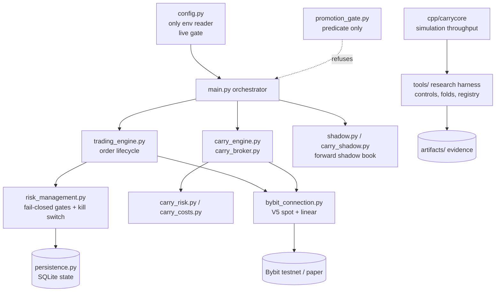

# Repository audit — iceccarelli/ai-agent-control

Audit date: 2026-10-28. Commit audited: `84ba866` (main). Read-only; nothing in the source tree was modified. Tests were run on a `git archive` copy in a scratch directory.

Labels: **[V]** verified in the tree or by execution, **[I]** inference, **[H]** hypothesis, **[U]** unknown.

## 0. Audit coverage (read this first)

This is a **partial** audit, not a line-by-line one.

| Area | Status |
|---|---|
| File inventory of all 926 tracked files | Done [V] |
| `bot/README.md`, `DEPLOYMENT.md` (head), `INTEGRATION_MAP.md` (head), `RESEARCH_CLOSE_STAGE1.md` (head) | Read |
| `config.py` live gate, `risk_management.py` kill-switch gate, `promotion_gate.py` (head), `project_status.py` FROZEN_ABSENT, `test_control_plane_boundary.py` (head), `carry-verify.yml` (head), `scripts/verify.sh` (head), `cpp/carrycore.h` (head) | Read |
| Artifacts: reviewer verdict, cash ledger, slice76 promotion gate | Read |
| Full test suite | **Executed** (see 7) |
| `trading_engine.py` (3,407 lines), `carry_engine.py` (2,942), `persistence.py` (2,738), `bybit_connection.py` (2,328), `policy.py`, `backtest.py`, `main.py`, `carry_broker.py`, most of `tools/` (92 files) | **Not read** [U] |
| Dependency CVE check | **Not done** (no network scanner; dependencies are only `requests`, `numpy`, `scipy`, `scikit-learn`) |

Every claim below about code I did not read is marked as coming from the repo's own documentation, not from verification.

## 1.1 Repository identity

- **What the name suggests**: an "AI agent control" product.
- **What it is** [V]: a Python research and execution bot for **Bybit V5** (spot + USDT-perp), default testnet/paper, centred on a **funding-rate carry** (delta-neutral spot/perp) book plus a statistical programme that tests and **freezes** directional trading signals. `bot/README.md:1` calls it "Bybit testnet execution bot". Nothing in the tree is an agent-governance product. The only "agent" notion is a "paper agent" certification (`bot/artifacts/slice42_paper_agent_certification.json`) and a rule that an LLM must not be on the order path (`bot/tests/test_control_plane_boundary.py:1-60`).
- **Intended user** [I]: the owner, a solo operator researching whether a carry strategy has an edge.
- **Maturity** [V]: research prototype with unusually strong engineering discipline. Not a product, no users, no release, no tag, no license.
- **License** [V]: **none** (no `LICENSE*` file). All rights reserved by default. Blocks open-source adoption and weakens diligence.
- **Git history** [V]: 145 commits, 2026-10-23 to 2026-10-28; 94 authored by "Claude", 51 by the owner. `DEPLOYMENT.md` mentions a prior 612-commit history (not present here), so this tree is an import/squash.
- **README vs implementation** [V]: the README is 11 lines and accurate but minimal. Other docs are stale or missing (see 1.5).

### What it demonstrably does
1. A Bybit client (spot and linear dialects) with a risk-gated order lifecycle (`bybit_connection.py`, `trading_engine.py`, `risk_management.py`) — per `INTEGRATION_MAP.md`; not read in full.
2. A two-leg **carry engine/broker/risk/cost** stack (`carry_engine.py`, `carry_broker.py`, `carry_risk.py`, `carry_costs.py`, `carry_shadow.py`) with a C++ simulation core (`cpp/carrycore.cpp`, 374 lines) explicitly described as a research-throughput tool, not a latency tool (`cpp/carrycore.h:3-20`).
3. A research harness: null-surrogate "control" validation, fold-based edge measurement, deflated Sharpe, hypothesis registry, frozen-signal registry (`project_status.py:122-175`).
4. A **promotion gate** that refuses live trading until 6 of 8 human/observational items are complete (`promotion_gate.py`; `artifacts/slice76_promotion_gate.json`).
5. Deployment to Fly.io, an off-by-default external watcher with Slack alerts (`.github/workflows/carry-watch.yml`).

### What it does not do
No on-chain code, no wallet/signing, no EVM/Solana/NEAR/Bittensor adapter, no agent-framework integration, no API server for third parties. [V] by file list (`git ls-files`).

### Trading-edge status (from the repo's own evidence) [V]
Every directional signal family is frozen ABSENT or INCONCLUSIVE against a 95.0 bar (`project_status.py:122-175`): technical_analysis 76.1/77.5; donchian 91.2/91.5; btc_alt_spillover 94.3/92.0 (ETH), 91.3/90.0 (SOL); post_shock_fade 1.6/2.0; range_location_fade and open_gap_fade not measurable. Forward shadow of the carry signal: **4 of 20** trades, **48 of 180** days (`artifacts/reviewer_verdict.json`), and the cash ledger note records "about -0.94 R on 4 trades" (`artifacts/cash_ledger.json`). The slice-76 gate shows 2 of 8 items complete, both machine-derived. **There is no evidence of a profitable edge.** The repo itself says so; I agree.

## 1.2 Technology and dependencies

- Python (Dockerfile `python:3.11-slim`, CI 3.11 and 3.12) [V]; C++ shared library built on demand via `cpp/Makefile`.
- Runtime deps (`bot/requirements.txt`): `requests>=2.31,<3`, `numpy>=1.24,<3`, optional `scipy`, `scikit-learn`. Pinned tested set in `bot/constraints.txt`: requests 2.33.1, numpy 2.4.4, scipy 1.17.1, scikit-learn 1.8.0. Very small supply-chain surface [V].
- Persistence: SQLite (`persistence.py`), and a **tracked** DB `bot/state/trading_state.db` (241,664 bytes; tables incl. kill_switch=1 row, decisions=87 rows, trades=0) [V].
- External: Bybit V5 REST/WS, Binance/Bitstamp/OKX public history for corpora, Fly.io, Slack webhook, AWS (`tools/aws_stack.py`).
- No wallet, blockchain, or LLM libraries; an AST test enforces no LLM import on the order path [V].
- CVE review: **not performed**. Pinned versions are recent; I make no vulnerability claim.

## 1.3 Architecture

Source: `bot/INTEGRATION_MAP.md` module graph (documented dependency direction "downward only"), cross-checked against file names. I did not independently verify the import graph beyond the AST test file existing.

Trust boundaries [I]: operator env → `config.load()`; Bybit API responses → broker (several tests named `*_fail_closed`, `*_unstated_fields`, `*_nan_*`, which indicates untrusted venue data is treated as hostile); LLM → none by design.

## 1.4 Feature inventory

| Feature | Status | Evidence | Tests | Limitations | Business relevance |
|---|---|---|---|---|---|
| Live-trading arming gate (testnet+paper default, exact ack token, both creds) | Fully implemented and verified | `config.py:63,694-760` | `test_config.py`, `test_live_promotion_check.py` (passed in my run) | Bybit-specific | High as a design pattern |
| Fail-closed kill switch, human-only clear | Implemented, verified | `risk_management.py:454-461,1495-1498`; kill-switch drill artifact | `test_kill_switch_drill.py` etc. passed | single-process, SQLite | High (pattern) |
| Promotion gate (predicate, cannot arm) | Implemented, verified | `promotion_gate.py:1-60` | `test_live_promotion_check.py` | requires human memo, 180-day forward window | Medium |
| LLM-off-order-path boundary test (AST) | Implemented | `tests/test_control_plane_boundary.py` | passed | Reviewer module "does not exist yet" (file docstring) | High (pattern) |
| Carry engine/broker/risk/costs | Implemented, heavily tested, not validated for profit | `carry_*.py`, ~60 `test_carry_*` files | passed | no demonstrated edge | Low as-is |
| Directional signals (10 modules) | Implemented, all frozen ABSENT/INCONCLUSIVE | `signals/`, `project_status.py:122` | per-signal tests | **no edge** | None |
| Research harness (controls, deflated Sharpe, registry) | Implemented | `tools/*`, `registration_discipline.py` | passed | Bybit/crypto-specific | Medium (methodology) |
| C++ carry simulator | Implemented | `cpp/carrycore.cpp` | differential test claimed | throughput-only | Low |
| Policy/ML layer | Partially (containment only) | `policy.py`, `ml_strategy.py`; `models/rejected/...` | `test_ml_containment.py` | no promoted model | Low |
| Fly deploy + watcher + Slack alerts | Implemented | `fly.toml`, `carry-watch.yml` | `test_watch_workflow.py` | needs secrets; not run | Low |
| Multi-user, API, dashboard, auth | **Missing** | - | - | - | Required for any SaaS |
| On-chain / wallet / agent-framework integrations | **Missing** | - | - | - | Required for options B/C |
| Docs: EDGE.md, TEST_REPORT.md, AGENT_CONTROL_PLANE.md, PAPER_AGENT_CERTIFICATION.md | **Referenced but absent from tree** | see 1.5 | - | evidence trail incomplete | - |

## 1.5 Code quality and maintainability

Strengths [V]: explicit fail-closed idiom (`_block(...)` on any exception, `risk_management.py:454-461`); single environment reader; structural tests (no dead imports, repo shape, image import closure); extensive negative tests; honest status language ("NOT READY for live capital", `DEPLOYMENT.md:3`).

Actionable findings:
1. **Missing referenced documents.** `EDGE.md`, `TEST_REPORT.md`, `docs/human/AGENT_CONTROL_PLANE.md` (cited at `tests/test_control_plane_boundary.py:3`), `docs/PROMOTION_GATE_MICRO_LIVE.md` (cited in the slice-76 gate JSON), and `docs/PAPER_AGENT_CERTIFICATION.md` are **not tracked**. The evidence trail (e.g. "EDGE.md §22") cannot be checked from this tree.
2. **Stale numbers in docs.** `DEPLOYMENT.md` requires "618 passed, 1 skipped"; `constraints.txt:1` cites a 4,953-test suite; my run collected 8,952 (18+8,533+386+15). `carry-verify.yml` header admits a "known baseline of 61 failures" and runs only a targeted subset.
3. **Repo clutter.** 392 files in `bot/artifacts/` (log-per-slice), 40 `patches/*.patch`, four root `.patch` files, though `.gitignore` lists `*.patch` (files were force-added). Raises onboarding cost.
4. **No LICENSE, no CONTRIBUTING, no CLAUDE.md/AGENTS.md** [V].
5. **Tracked mutable state**: `bot/state/trading_state.db` is in git and not ignored; `scripts/verify.sh` md5-checks it before/after tests, which suggests the owner is aware of drift.
6. **Very large modules** (`trading_engine.py` 3,407 lines; `carry_engine.py` 2,942) — [I] coupling risk; unread.

## 1.7 Tests and execution

Environment: Python 3.13.17, pytest 9.1.1 (pre-installed). I did not install anything. `numpy`/`requests` were reachable via `PYTHONPATH=/usr/local/lib/python3.13/dist-packages`; **`scipy` and `scikit-learn` were not available**.

Command (in a scratch copy of HEAD): `PYTHONPATH=/usr/local/lib/python3.13/dist-packages pytest tests -q --no-header -p no:cacheprovider`

Result [V]: **18 failed, 8533 passed, 386 skipped, 15 xpassed, 6 warnings in 531 s.**

The 18 failures: 17 in `test_control_rule.py` and 1 in `test_carry_shadow.py::TestShippedInTheProductionImage`. I confirmed the cause for the first failure in each group: `ModuleNotFoundError: scipy` (`tools/control_directed.py:131`) and `FAULT: ModuleNotFoundError: numpy` from a subprocess using an isolated interpreter. I did **not** re-run with scipy present, so "environmental" is strongly indicated but not proven for the other 16. Coverage was not measured. The 386 skips were not itemised.

CI reality [V]: `carry-verify.yml` runs a targeted subset, not the full suite. No evidence in the tree that the full suite is green in CI.

## 1.8 Scorecard (0-5)

| Dimension | Score | Reason |
|---|---|---|
| Functional completeness (vs. "agent control") | 0 | The product named does not exist |
| Functional completeness (vs. its real purpose, a carry research bot) | 3 | Wide, tested, no edge |
| Architecture | 3 | Clear layering, fail-closed; unread large modules; single venue |
| Security (as a trading bot) | 3.5 | Strong gating idioms; credential history unresolved; no audit by third party |
| Testing | 4 | 8.5k passing tests, negative cases; not hermetic, CI covers a subset |
| Documentation | 2 | Dense but stale/missing referenced docs; 11-line README |
| Developer experience | 2 | Cluttered, no license, special env for deps |
| Extensibility | 2.5 | Venue adapter seam exists for Bybit only |
| Production readiness | 1 | Self-declared NOT READY; no live path |
| Commercial readiness | 0.5 | No license, users, packaging, API, or demonstrated edge |

## Five most important findings (severity x commercial impact)

1. **Name/product mismatch.** There is no agent-governance product here; the asset is a Bybit carry research bot with no demonstrated edge.
2. **No licence, users, distribution** — nothing to sell or to adopt as it stands.
3. **Evidence trail broken**: key documents referenced by code and artifacts are missing; docs/test counts are stale.
4. **Credential history unresolved**: `DEPLOYMENT.md:7-25` says live Bybit keys were in the original source and must be treated as compromised; the tree cannot show they were rotated [U].
5. **Test suite not hermetic and CI covers a subset** (18 failures here from missing optional deps; "61 failures" baseline admitted in CI header).
